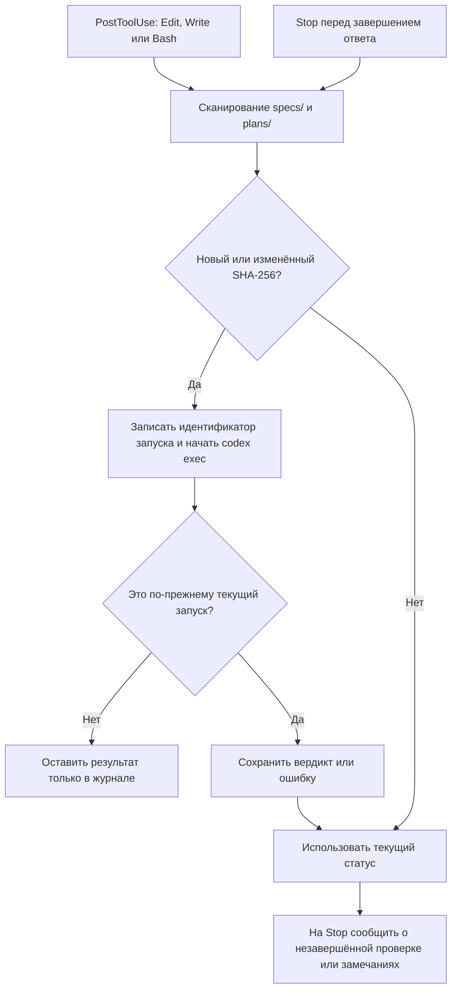
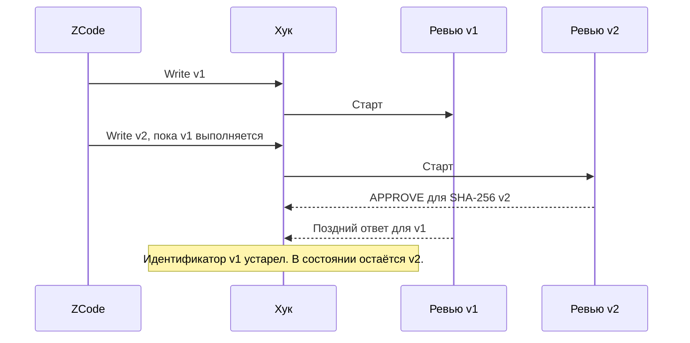

# ZCode Plan Review

ZCode Plan Review автоматически отправляет спецификации и планы Superpowers на независимое ревью в Codex CLI. Когда автор меняет план во время проверки, ZCode получает вердикт для последней версии документа.

## Зачем это нужно

Раньше в инструкциях агента было написано «после сохранения плана запусти ревью». Агент мог закончить ответ словами `Plan complete` и пропустить этот шаг. Мы перенесли запуск в два события ZCode. Первое замечает запись и начинает проверку. Второе сверяет документ перед завершением ответа и подхватывает запись, которую первое событие пропустило.

Ревьюер запускается локальной командой `codex exec -s read-only` из корня проекта. Он читает документ и при необходимости сверяется с кодом. Codex использует настроенного у разработчика провайдера: обычное ревью передаёт контекст модели и расходует её лимиты. Решение об исправлениях принимает автор плана.

## Начать работу

Потребуются ZCode с командными хуками, Python 3.10+ на POSIX и авторизованный Codex CLI, доступный как `codex` в PATH процесса ZCode. Открой сессию в корне Git-проекта. Superpowers создаёт документы в `docs/superpowers/specs/*.md` и `docs/superpowers/plans/*.md`. Для проверки вручную можно создать Markdown в одном из этих каталогов.

```sh
git clone https://github.com/elektrobober/zcode-plan-review.git
cd zcode-plan-review
python3 --version
codex --version
codex login status
./install zcode
./test-live zcode
```

После установки открой **новую сессию ZCode**. Попроси сохранить спецификацию или план. Дождись вердикта в ответе агента. Старые документы при первом сканировании получают статус `baseline`, если их время изменения предшествует установке. Проверка начнётся после изменения содержимого.

`./install zcode` копирует обработчик в `~/.zcode/hooks/zcode-plan-review/`, добавляет две команды в `~/.zcode/cli/config.json` и отмеченный блок инструкций в `~/.zcode/AGENTS.md`. Повторный запуск обновляет обработчик. При изменении существующего JSON рядом сохраняется резервная копия. Явно выключенные хуки требуют отдельного решения владельца.

Если уже используется прежний одиночный скрипт `superpowers-review.py`, установщик обнаружит его стандартные команды. Для переноса используй `./install zcode --migrate-legacy`: команда заменяет обе регистрации. Старые отчёты и файлы остаются на месте. Удали прежний написанный вручную абзац про `superpowers-review.py status` из инструкций ZCode, чтобы у агента был один актуальный путь. Нестандартные регистрации проверь вручную.

## Что происходит с планом



SHA-256 позволяет пропустить повторное сохранение того же текста. У каждой попытки отдельные файлы отчёта и идентификатор. Даже если автор вернул старый текст, запоздавший процесс не может заменить результат более нового запуска. Состояние хранится на машине разработчика, изменения сериализуются файловой блокировкой. В каталоге проекта для работы хука достаточно самого плана.

| Состояние | Что делает агент |
|---|---|
| `running` | Дожидается результата и повторно читает статус. |
| `done / APPROVE` | Сообщает вердикт вместе с завершением плана. |
| `done / NEEDS_CHANGES` | Читает существенные замечания в отчёте и исправляет план. Три последовательных отказа завершают цикл: агент докладывает оставшиеся замечания владельцу. |
| `error` | Сообщает об ошибке. Подробности — в файле `.log` рядом с `.out`. |
| `baseline` | Документ существовал до установки и ещё не проходил проверку. |

Первый блокирующий `Stop` возвращает код 2. При повторном `stop_hook_active` обработчик выводит причину и разрешает завершение, чтобы ошибка провайдера не заперла сессию. Разрешение завершить ответ само по себе не означает `APPROVE`. Гейт проверяет документы в корне текущей сессии. При записи по абсолютному пути в другом проекте ревью может стартовать там; статус такого документа смотри из того проекта.

## Как проверить установку и разобраться с ошибкой

```sh
# Из корня проекта, где лежит план
python3 ~/.zcode/hooks/zcode-plan-review/review.py status "$PWD"
```

Статус показывает префикс хеша, вердикт и путь `report=` к полному ответу. Для сравнения с файлом на macOS используй `shasum -a 256 путь/к/плану.md`. Если строки нет, проверь рабочий каталог, путь к документу и что сессия открыта после установки. Если статус `error`, проверь доступность Codex из среды ZCode, авторизацию и журнал. Таймаут ревью — 10 минут. Зависшая запись старше 20 минут при следующем Stop получает статус ошибки. Автоматического повтора для того же хеша нет.

**Что доказывает test-live.** Команда устанавливает пакет в отдельный временный профиль, запускает настоящий ZCode CLI и подаёт ему два вызова инструмента Write через локальный HTTP-сервер. Локальная заглушка Codex доступна только дочерним процессам теста и проверяет каталог проекта. Тест задерживает первый ответ до завершения второго. Затем он дожидается выхода первого воркера и сравнивает SHA-256 на диске, в отчёте и в состоянии хука. Успех — строка `PASS: two ZCode writes, two reviews`. Качество ответа модели и доступ к реальному Codex API проверяет обычное ревью.



По умолчанию тест ищет приложение в `/Applications/ZCode.app`. Если ZCode установлен иначе, передай `./test-live zcode --cli /path/to/zcode --builtin /path/to/zcode-builtin.json`. Для CLI в формате `.cjs` требуется Node.js. Временный профиль удаляется после прогона. Для локальных проверок разработчика нужны `make` и `uvx` (Ruff фиксированной версии скачивается при первом запуске).

## На чём проверено

| Компонент | Установка, на которой воспроизведён сценарий |
|---|---|
| ОС | macOS 15.4.1, arm64 |
| ZCode Desktop / вложенный CLI | 3.17.2 / 0.17.1 |
| Python / Node.js | 3.14.6 / 22.23.1 |
| Codex CLI на машине | 0.167.0-alpha.3.2; в test-live работает локальная заглушка |
| Статические проверки | Ruff 0.14.4 |

Это проверенная конфигурация. Для другого выпуска ZCode прогони test-live: от версии зависят формат событий, вызов Write и загрузка хуков. Windows не проверялась; обработчик использует POSIX flock.

## Удаление

Закрой рабочие сессии с активным ревью, выполни `./uninstall zcode` и открой новую сессию. Команда убирает свои регистрации, установленный скрипт и блок инструкций. Журналы, состояние и резервные копии остаются доступны владельцу. Для обновления клона выполни `git pull --ff-only`, затем снова `./install zcode`.

Для сопровождения см. [инструкции агенту](AGENTS.md).
